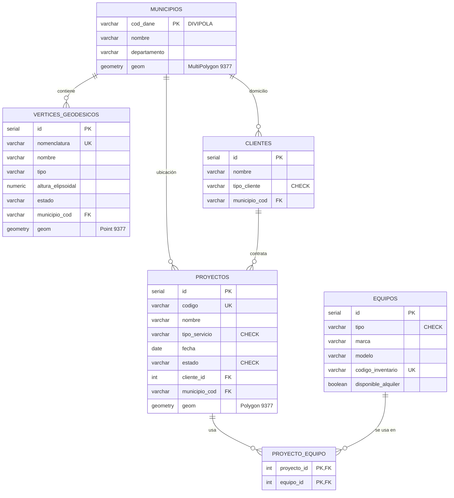
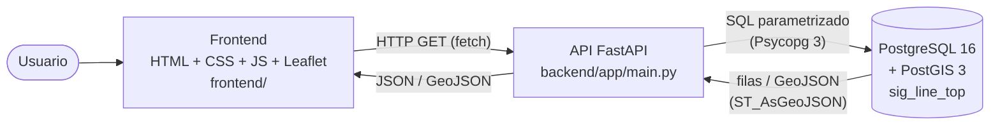
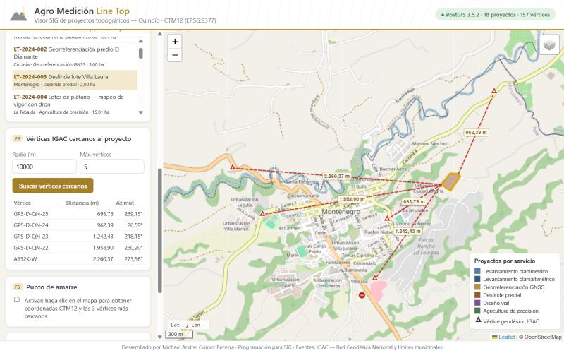
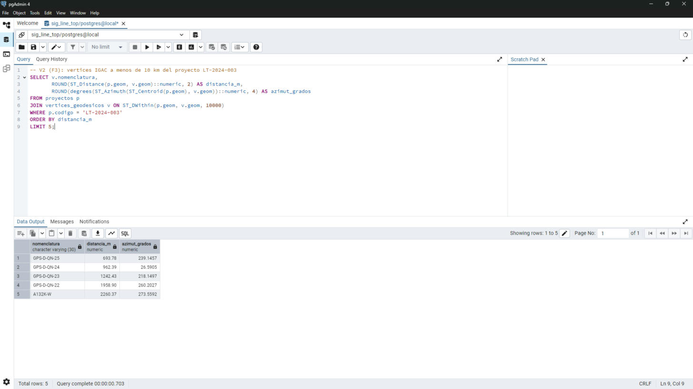

# Visor SIG Web — Agro Medición Line Top

**Tarea integradora · Programación para SIG**
Aplicación SIG Web cliente-servidor (Leaflet + FastAPI + Psycopg + PostgreSQL/PostGIS) para gestionar y consultar los **proyectos topográficos** de la empresa *Agro Medición Line Top* en el departamento del **Quindío**, relacionándolos con la **Red Geodésica Nacional del IGAC** y con los **límites municipales**.

---

## 1. Objetivo y alcance

**Problema geográfico.** Antes de un levantamiento, el topógrafo necesita saber qué vértices geodésicos del IGAC tiene cerca para amarrar el trabajo a MAGNA-SIRGAS. Además, la empresa necesita saber dónde ha trabajado, para quién, con qué equipos y cuántas hectáreas ha levantado en cada municipio.

**Preguntas que responde el visor:**

1. ¿Dónde están los proyectos de la empresa, los vértices geodésicos y los municipios del Quindío? (F1)
2. ¿Cuál es la información de un proyecto: cliente, equipos usados, área y perímetro? (F2)
3. ¿Qué vértices geodésicos del IGAC hay a menos de *X* metros de un proyecto, a qué distancia y con qué azimut? (F3)
4. ¿Cuántas hectáreas se han levantado por municipio según el tipo de servicio, el estado o el año? (F4)
5. Si hago clic en un punto, ¿cuáles son sus coordenadas CTM12, en qué municipio cae y cuáles son los 3 vértices más cercanos para amarrarlo? (F5)

**Alcance.** Visor de escritorio para uso local (no requiere servidor público), con datos del Quindío y coordenadas en el sistema oficial **MAGNA-SIRGAS / Origen-Nacional (CTM12, EPSG:9377)**.

---

## 2. Fuentes de información

| Tabla | Fuente | Formato original | Geometría | Sistema de referencia |
|---|---|---|---|---|
| `municipios` | Límites de entidades territoriales del IGAC, publicados en el geoportal del Ministerio de Ambiente (servicio `MADS_Geoportal_Lec`, capa *Municipio*, filtro `dpcodigo = '63'`). Archivo: `datos_fuente/municipios_quindio_igac.geojson` | GeoJSON (ArcGIS REST) | MultiPolygon | Original: EPSG:4326 → almacenado en EPSG:9377 |
| `vertices_geodesicos` | IGAC — [Red Geodésica Nacional](https://redgeodesica.igac.gov.co/redes/red_pasiva.html), Red Pasiva GNSS MAGNA-SIRGAS, tabla pública filtrada al departamento del Quindío (157 vértices). Archivo: `datos_fuente/vertices_red_pasiva_quindio.csv` | CSV (latitud, longitud, altura elipsoidal, orden, materialización, estado) | Point | Original: MAGNA-SIRGAS geográficas → almacenado en EPSG:9377 |
| `clientes` | Registro propio de Agro Medición Line Top | — | — | — |
| `equipos` | Inventario propio de Agro Medición Line Top | — | — | — |
| `proyectos` | Polígonos de los levantamientos de la empresa | WKT en CTM12 | Polygon | EPSG:9377 |
| `proyecto_equipo` | Registro propio (equipos usados por proyecto) | — | — | — |

> Los datos del IGAC son abiertos. En `datos_fuente/LEEME.md` está el procedimiento para obtenerlos de nuevo. El script `scripts/geojson_a_sql.py` convierte esos archivos en `sql/02_datos_igac.sql`.
> **Nota sobre los proyectos y clientes:** son proyectos demostrativos ubicados en el Quindío para mostrar el funcionamiento del visor. Sus nombres no corresponden a personas reales y sus polígonos no representan linderos oficiales. El municipio de cada vértice no se copió del archivo: se calculó en PostGIS con `ST_Contains`.

---|---|---|---|---|
| `municipios` | IGAC — [Colombia en Mapas](https://www.colombiaenmapas.gov.co), límites municipales | Shapefile / GeoJSON | MultiPolygon | Original: _(completar)_ → almacenado en EPSG:9377 |
| `vertices_geodesicos` | IGAC — Red Geodésica Nacional, red pasiva ([Colombia en Mapas](https://www.colombiaenmapas.gov.co)) | _(completar)_ | Point | Original: MAGNA-SIRGAS (EPSG:4686) → almacenado en EPSG:9377 |
| `clientes` | Registro propio de Agro Medición Line Top | — | — | — |
| `equipos` | Inventario propio de Agro Medición Line Top | — | — | — |
| `proyectos` | Polígonos de los levantamientos de la empresa | WKT en CTM12 | Polygon | EPSG:9377 |
| `proyecto_equipo` | Registro propio (equipos usados por proyecto) | — | — | — |

> Los datos del IGAC son abiertos y se descargan sin registro desde Colombia en Mapas. En la carpeta `datos_fuente/` está el procedimiento y, cuando fue posible, los archivos originales.
> **Nota sobre los proyectos y clientes:** son proyectos demostrativos ubicados en el Quindío para mostrar el funcionamiento del visor. Sus nombres no corresponden a personas reales y sus polígonos no representan linderos oficiales.

---

## 3. Modelo relacional (6 tablas)



**Integridad referencial:**
- `proyectos.cliente_id → clientes.id` y `proyectos.municipio_cod → municipios.cod_dane` con `ON DELETE RESTRICT`: no se puede borrar un cliente o un municipio que tenga proyectos.
- `proyecto_equipo` resuelve la relación muchos a muchos (un proyecto usa varios equipos y un equipo se usa en varios proyectos). Su clave primaria es compuesta.
- Restricciones `CHECK` para el tipo de servicio, el estado, el tipo de cliente y el tipo de equipo. `CHECK (ST_IsValid(geom))` para los polígonos.
- Índices espaciales GiST en las tres geometrías.

---

## 4. Arquitectura



| Componente | Archivo | Responsabilidad |
|---|---|---|
| Interfaz | `frontend/index.html`, `frontend/css/estilos.css` | Estructura y estilos del visor |
| Comunicación HTTP | `frontend/js/api.js` | `pedirJSON()`: hace los `fetch` y registra cada petición (URL, código HTTP, tiempo) |
| Mapa | `frontend/js/mapa.js` | Leaflet, mapas base, capas GeoJSON, leyendas y mapa temático |
| Interacciones | `frontend/js/app.js` | Eventos del usuario → llamadas a los endpoints → actualización del mapa y del panel |
| Endpoints | `backend/app/main.py` | Rutas FastAPI, validación de parámetros y respuestas |
| Consultas SQL | `backend/app/consultas.py` | Todas las sentencias SQL/PostGIS, documentadas |
| Conexión | `backend/app/db.py` | Conexión Psycopg con credenciales leídas desde `backend/.env` |
| Geodatabase | `sql/01…04_*.sql` | Estructura, datos y consultas de verificación |

**Seguridad:**
- Las credenciales están en `backend/.env`, que está en `.gitignore`. En el repositorio solo está la plantilla `backend/.env.example`.
- Todas las consultas que reciben valores del usuario usan parámetros de Psycopg (`%(nombre)s`). El texto del usuario nunca se concatena en el SQL. Por ejemplo, en la búsqueda el comodín `%` se agrega en Python y el valor viaja como parámetro.
- FastAPI valida tipos y rangos: `radio_m` entre 0 y 100 000, `limite` entre 1 y 20, latitud y longitud dentro de Colombia.

---

## 5. Requisitos de instalación

- **PostgreSQL 16** (o 14+) con **PostGIS 3** (en Windows, PostGIS se instala con *Stack Builder*).
- **Python 3.10** o superior.
- Navegador web moderno. Leaflet se carga desde CDN (requiere internet).

## 6. Instalación y ejecución

### Opción rápida en Windows (doble clic)

`INICIAR_VISOR.bat` hace todo el proceso:
- Crea una instancia local de PostgreSQL 16 en el puerto 5433, en la carpeta del usuario y accesible solo desde el equipo.
- Crea la base y carga los scripts 01–03.
- Instala las dependencias de Python.
- Abre el visor.

Requiere PostgreSQL 16 con PostGIS (instalados en `C:\Program Files\PostgreSQL\16`) y Python. Las variables de conexión se definen dentro del `.bat`, así que no se necesita archivo `.env`.

### 6.1 Crear la geodatabase (procedimiento manual)

En pgAdmin, cree la base de datos `sig_line_top`. Luego abra el *Query Tool* y ejecute los scripts **en este orden** (abrir el archivo → ejecutar ▶):

| Orden | Script | Contenido |
|---|---|---|
| 1 | `sql/01_estructura.sql` | Extensión PostGIS, registro de EPSG:9377 si falta, tablas, claves e índices |
| 2 | `sql/02_datos_igac.sql` | Municipios y vértices geodésicos del IGAC (Quindío) |
| 3 | `sql/03_datos_empresa.sql` | Clientes, equipos, proyectos y proyecto_equipo |
| 4 | `sql/04_consultas_verificacion.sql` | Consultas de verificación (opcional, para evidencias) |

También se puede hacer desde la consola:

```bash
createdb -U postgres sig_line_top
psql -U postgres -d sig_line_top -f sql/01_estructura.sql
psql -U postgres -d sig_line_top -f sql/02_datos_igac.sql
psql -U postgres -d sig_line_top -f sql/03_datos_empresa.sql
```

### 6.2 Configurar y ejecutar el backend

```bash
cd backend
python -m pip install -r requirements.txt
copy .env.example .env        # en Windows (en Linux/Mac: cp .env.example .env)
# editar .env y escribir la contraseña de PostgreSQL
python -m uvicorn app.main:app --reload
```

- API y documentación interactiva (Swagger): <http://127.0.0.1:8000/docs>
- Verificación rápida de la conexión: <http://127.0.0.1:8000/api/estado>

### 6.3 Abrir el frontend

La misma API sirve el visor en **<http://127.0.0.1:8000/>**.
También se puede abrir `frontend/index.html` con *Live Server* (puerto 5500). En ese caso `api.js` apunta a `http://127.0.0.1:8000`, y CORS está habilitado.

---

## 7. Funcionalidades y endpoints

| # | Funcionalidad | Endpoint | Operación PostGIS principal |
|---|---|---|---|
| — | Estado de la conexión | `GET /api/estado` | `postgis_lib_version()`, conteos |
| — | Catálogos de filtros | `GET /api/catalogos` | `SELECT DISTINCT` |
| **F1** | Visualización de capas | `GET /api/municipios`<br>`GET /api/vertices`<br>`GET /api/proyectos` | `ST_Transform(geom, 4326)` + `ST_AsGeoJSON` + `json_agg` → FeatureCollection |
| **F2** | Consulta de atributos (clic o búsqueda) | `GET /api/proyectos/{id}`<br>`GET /api/proyectos?buscar=texto` | JOIN de 5 tablas, `ST_Area`, `ST_Perimeter`, `ST_Centroid`, `ST_Covers` |
| **F3** | Consulta espacial: vértices cercanos | `GET /api/proyectos/{id}/vertices-cercanos?radio_m=10000&limite=5` | `ST_DWithin`, `ST_Distance`, `ST_ShortestLine`, `ST_Azimuth` |
| **F4** | Filtro combinado + mapa temático | `GET /api/proyectos?municipio=&tipo=&estado=&anio=`<br>`GET /api/estadisticas/municipios?tipo=&estado=&anio=` | `ST_Intersects` + `ST_Intersection` + `SUM(ST_Area)` |
| **F5** | Punto de amarre (clic en el mapa) | `GET /api/punto?lat=&lon=` | `ST_Transform` a CTM12, `ST_Contains`, KNN `<->`, `ST_Distance`, `ST_Azimuth` |

### Justificación de la consulta espacial (F3)

- **Tipos de geometría:** se mide la distancia entre un **polígono** (área del proyecto) y un **punto** (vértice). `ST_Distance` devuelve la distancia **mínima** desde el borde del polígono; si el vértice está dentro del proyecto, la distancia es 0. `ST_ShortestLine` construye la línea que materializa esa distancia, y esa línea es la que se dibuja en Leaflet.
- **Sistema de referencia:** las geometrías se guardan en **EPSG:9377 (CTM12)**, la proyección cartográfica oficial de Colombia (Resolución IGAC 471 de 2020). Por eso las distancias y áreas salen en **metros**. Si se usara EPSG:4326, `ST_Distance` devolvería **grados**, que no sirven como medida de longitud.
- **Unidades y precisión:** `radio_m` se recibe en metros y `ST_DWithin` lo aplica directamente aprovechando el índice GiST. CTM12 es una proyección Transversa de Mercator con k₀ = 0,9992 y meridiano central −73°. En el Quindío (~2,7° al oeste) el factor de escala ronda 1,0003, de modo que la distancia plana difiere ≈0,03 % de la elipsoidal. El script `04_consultas_verificacion.sql` compara ambas (`geometry` en CTM12 vs `geography` sobre GRS80). La ficha del proyecto (F2) muestra también el área plana y la elipsoidal.
- **Azimut:** `ST_Azimuth` en CTM12 entrega el **azimut de cuadrícula** (medido desde el norte de la cuadrícula, en sentido horario), que es el que usa el topógrafo en campo.

---

## 8. Demostración: recorrido completo de una operación (F3)

**Interacción del usuario → endpoint → consulta SQL/PostGIS → respuesta GeoJSON → representación en Leaflet**

1. **Interacción.** El usuario hace clic en el proyecto *LT-2024-003* (F2), escribe un radio de 10 000 m y pulsa **"Buscar vértices cercanos"** (`frontend/js/app.js`, función `buscarVerticesCercanos()`).
2. **Petición HTTP.** `pedirJSON()` (`frontend/js/api.js`) envía:
   `GET http://127.0.0.1:8000/api/proyectos/3/vertices-cercanos?radio_m=10000&limite=5`
   La petición queda en el panel *Registro de peticiones HTTP* del visor y en la pestaña *Red* (F12) del navegador.
3. **Endpoint.** FastAPI (`backend/app/main.py`, función `vertices_cercanos`) valida que `radio_m` y `limite` estén en rango, verifica que el proyecto exista (si no, responde 404) y ejecuta `SQL_VERTICES_CERCANOS` con los parámetros `{"id": 3, "radio_m": 10000, "limite": 5}`.
4. **Consulta PostGIS** (`backend/app/consultas.py`):
   ```sql
   FROM proyectos p
   JOIN vertices_geodesicos v ON ST_DWithin(p.geom, v.geom, %(radio_m)s)
   WHERE p.id = %(id)s
   ORDER BY ST_Distance(p.geom, v.geom)
   LIMIT %(limite)s
   ```
   Además calcula `ST_ShortestLine`, `ST_Azimuth` y transforma el resultado con `ST_Transform(..., 4326)` → `ST_AsGeoJSON`.
5. **Respuesta.** Un `FeatureCollection` cuyos *features* son `LineString` (proyecto → vértice) con propiedades `nomenclatura`, `distancia_m`, `azimut_grados`, `este_ctm12`, `norte_ctm12`, `lat` y `lon`.
6. **Representación.** `L.geoJSON(...)` dibuja las líneas punteadas con la distancia como etiqueta. También resalta los vértices en rojo y llena la tabla del panel lateral.
7. **Verificación independiente.** La consulta **V2** de `sql/04_consultas_verificacion.sql`, ejecutada en pgAdmin, devuelve las mismas distancias y azimuts que el visor (ver evidencia 5).

---

## 9. Evidencias técnicas

Las capturas se tomaron con la aplicación ejecutándose localmente (PostgreSQL 16.8 + PostGIS 3.5.2 en Windows) y están en `docs/evidencias/`.

| # | Archivo | Qué demuestra |
|---|---|---|
| 1 | `01_api_estado.jpg` | `GET /api/estado`: conexión real API ↔ PostgreSQL/PostGIS y número de registros por tabla |
| 2 | `02_swagger_docs.jpg` | Documentación automática de los endpoints (`/docs`) |
| 3 | `03_visor_f1.jpg` | **F1**: municipios, vértices geodésicos y proyectos consultados desde PostGIS y dibujados en Leaflet |
| 4 | `04_respuesta_geojson_f3.jpg` | Respuesta GeoJSON (`FeatureCollection` de `LineString`) de `GET /api/proyectos/3/vertices-cercanos?radio_m=10000&limite=5` |
| 5 | `05_f3_visor.jpg` y `05_f3_pgadmin.jpg` | **F3 contrastada**: los vértices, distancias y azimuts del visor coinciden con la consulta V2 ejecutada directamente en pgAdmin |
| 6 | `06_f2_ficha.jpg` | **F2**: ficha del proyecto (JOIN de 5 tablas, área CTM12 vs. elipsoidal, perímetro, centroide, equipos) |
| 7 | `07_f4_tematico.jpg` | **F4**: filtro por tipo de servicio y mapa temático de hectáreas por municipio (`ST_Intersection`) |
| 8 | `08_f5_amarre_y_registro_http.jpg` | **F5**: punto de amarre (CTM12 + 3 vértices más cercanos) y panel con el registro de peticiones HTTP |

**Verificación independiente (F3, proyecto LT-2024-003, radio 10 km):**

| Vértice | Distancia visor (m) | Distancia pgAdmin (m) | Azimut (°) |
|---|---|---|---|
| GPS-D-QN-25 | 693,78 | 693.78 | 239.1457 |
| GPS-D-QN-24 | 962,39 | 962.39 | 26.5905 |
| GPS-D-QN-23 | 1.242,43 | 1242.43 | 218.1497 |
| GPS-D-QN-22 | 1.958,90 | 1958.90 | 260.2027 |
| A132K-W | 2.260,37 | 2260.37 | 273.5592 |




## 10. Estructura del repositorio

```
├── README.md
├── .gitignore
├── backend/
│   ├── .env.example          ← plantilla de credenciales (el .env real NO se publica)
│   ├── requirements.txt
│   └── app/
│       ├── main.py           ← endpoints FastAPI
│       ├── consultas.py      ← consultas SQL/PostGIS
│       └── db.py             ← conexión Psycopg
├── frontend/
│   ├── index.html
│   ├── css/estilos.css
│   └── js/
│       ├── api.js            ← peticiones HTTP
│       ├── mapa.js           ← Leaflet y capas
│       └── app.js            ← interacciones
├── sql/
│   ├── 01_estructura.sql
│   ├── 02_datos_igac.sql
│   ├── 03_datos_empresa.sql
│   └── 04_consultas_verificacion.sql
├── datos_fuente/             ← archivos originales IGAC y procedimiento de descarga
├── scripts/geojson_a_sql.py  ← conversión de los datos IGAC a SQL
└── docs/evidencias/          ← capturas de funcionamiento
```

## 11. Relación con el proyecto de referencia

Se tomó del Módulo 05 (SIG Web del Quindío) el **patrón de arquitectura**: FastAPI + Psycopg + GeoJSON construido en PostGIS + Leaflet. El problema, el modelo de datos, las consultas y la interfaz son propios:

- Geometrías almacenadas en CTM12 (EPSG:9377) para medir en metros sin transformar en cada consulta.
- Distancia polígono–punto con línea más corta y azimut de cuadrícula.
- Superposición espacial (`ST_Intersection`) para el mapa temático.
- Punto de amarre con búsqueda KNN.
- Relación muchos a muchos proyectos–equipos.
- Registro visible de las peticiones HTTP.

---

**Autor:** Michael Andrei Gómez Becerra · Ingeniería Topográfica y Geomática · 2026
